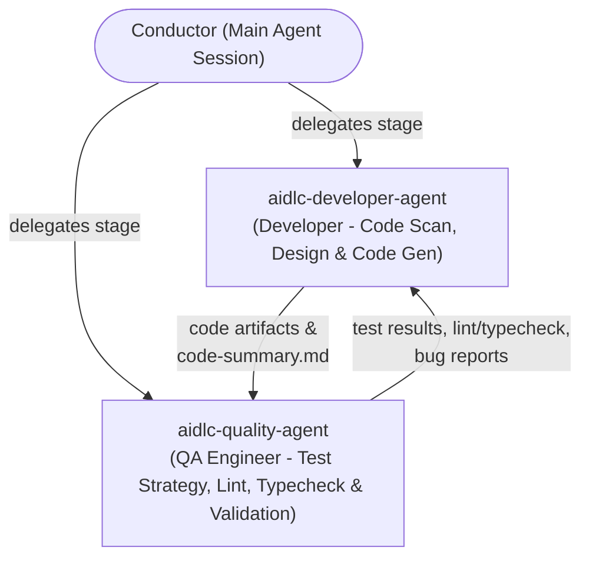

# AI-DLC Two-Agent Harness (`aidlc-developer-agent` & `aidlc-quality-agent`)

> Based on [AWS AI-DLC Workflows](https://github.com/awslabs/aidlc-workflows) (`00-introduction.md` & `06-agents.md`) tailored for this **Next.js 16 App Router** workspace (`raynue`).

---

## 1. Architecture & Philosophy

Instead of a large waterfall chain of narrow specialists, this workspace runs a streamlined **Two-Agent AI-DLC Mob** orchestrated by the **Conductor** (the primary agent session):

1. **[`aidlc-developer-agent`](./agents/aidlc-developer-agent.md)** *(Senior Developer — `judgment` tier)*
   - **Leads**: Reverse Engineering (`reverse-engineering`), Code Generation (`code-generation`)
   - **Supports**: Practices Discovery (`practices-discovery`), User Stories (`user-stories`), Functional Design (`functional-design`), Deployment Execution (`deployment-execution`)
2. **[`aidlc-quality-agent`](./agents/aidlc-quality-agent.md)** *(QA & Performance Engineer — `judgment` tier)*
   - **Leads**: Build and Test (`build-and-test`), Performance Validation (`performance-validation`)
   - **Supports**: Practices Discovery (`practices-discovery`), User Stories (`user-stories`), NFR Requirements (`nfr-requirements`)

---

## 2. Streamlined Lifecycle Phases & Stages

Across the AI-DLC lifecycle, the Conductor routes work through these core stages using only the two agents:

| Phase | Stage | Mode / Topology | Lead Agent | Support Agent | Output / Gate |
| :--- | :--- | :--- | :--- | :--- | :--- |
| **Inception** | `2.1 Reverse Engineering` | `pipeline` / `inline` | `aidlc-developer-agent` | — | Deep scan of `src/app`, `src/components`, `src/lib`, `data/`, and `package.json` |
| **Inception** | `2.2 Practices Discovery` | `subagent` (hub-and-spoke) | `aidlc-developer-agent` | `aidlc-quality-agent` | Code conventions, Next.js 16 patterns, and testing posture |
| **Inception** | `2.4 User Stories` | `mob` | `aidlc-developer-agent` | `aidlc-quality-agent` | Implementable stories with testable acceptance criteria |
| **Construction** | `3.1 Functional Design` | `inline` | `aidlc-developer-agent` | `aidlc-quality-agent` | Next.js Route Handlers (`src/app/api/*`), Server/Client boundaries, data models (`src/types/*`) |
| **Construction** | `3.5 Code Generation` | `subagent` | `aidlc-developer-agent` | — | Production code written to workspace root + unit happy-path tests |
| **Construction** | `3.6 Build and Test` | `subagent` / `inline` | `aidlc-quality-agent` | `aidlc-developer-agent` | `npm run typecheck`, ESLint, Vitest unit tests, Playwright E2E, `npm run build` |
| **Operation** | `4.6 Performance Validation` | `inline` | `aidlc-quality-agent` | `aidlc-developer-agent` | Core Web Vitals, bundle/caching review, NFR validation matrix |

---

## 3. Orchestration Rules for the Harness

1. **Automated End-to-End Execution**: The Conductor dispatches `aidlc-developer-agent` and `aidlc-quality-agent` (via `define_subagent` / `invoke_subagent` or inline persona adoption) and runs all stages autonomously without pausing for intermediate stage approvals. **Only notify or ask the user when changing the plan or editing `AGENTS.md`** (and upon final task completion).
2. **Project-Scoped Command Execution**: Always invoke quality and Git commands directly inside the workspace root (`npm run typecheck`, `npm run lint`, `npm test`, ` npx vitest run`, `npm run test:e2e`, `npx playwright test`, `npm run build`, `git ...`) without referencing paths outside the repo or prepending shell exports.
3. **Next.js 16 Docs First**: Before designing, implementing, or testing any Next.js feature, both agents **MUST** consult the local Next.js documentation index in [`AGENTS.md`](../AGENTS.md) (`./node_modules/next/dist/docs/`).
4. **Adversarial Quality Loop in Construction**:
   - After `aidlc-developer-agent` completes `code-generation`, `aidlc-quality-agent` runs `build-and-test` (`typecheck`, `lint`, `test`, `test:e2e`, `build`).
   - On any failure or unmet acceptance criterion (**NOT-READY**), findings are returned to `aidlc-developer-agent` to fix and re-verify automatically.
5. **Workspace vs. Intent Artifacts**:
   - Application source code and tests are written directly to the workspace (`src/`, `__tests__/`, `tests/`).
   - Stage plans, code summaries, and review verdicts are recorded in the conversation artifacts or `aidlc/spaces/<space>/intents/<YYMMDD>-<label>/`.

---

## 4. Subagent Registration Quick Reference (Antigravity Harness)

When running in Antigravity, the Conductor can register both agents via `define_subagent`:

- **`aidlc-developer-agent`**:
  - `EnableWriteTools: true`, `EnableSubagentTools: false`, `EnableMCPTools: true`
  - System Prompt: Load [`aidlc/agents/aidlc-developer-agent.md`](./agents/aidlc-developer-agent.md)
- **`aidlc-quality-agent`**:
  - `EnableWriteTools: true`, `EnableSubagentTools: false`, `EnableMCPTools: true`
  - System Prompt: Load [`aidlc/agents/aidlc-quality-agent.md`](./agents/aidlc-quality-agent.md)
